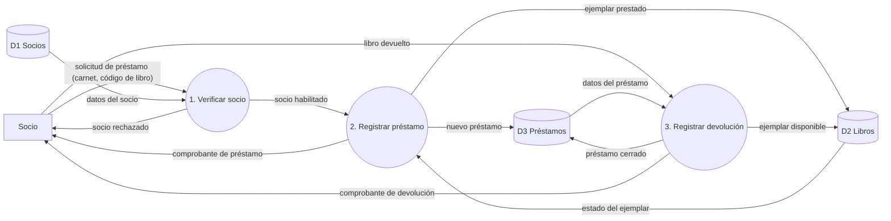
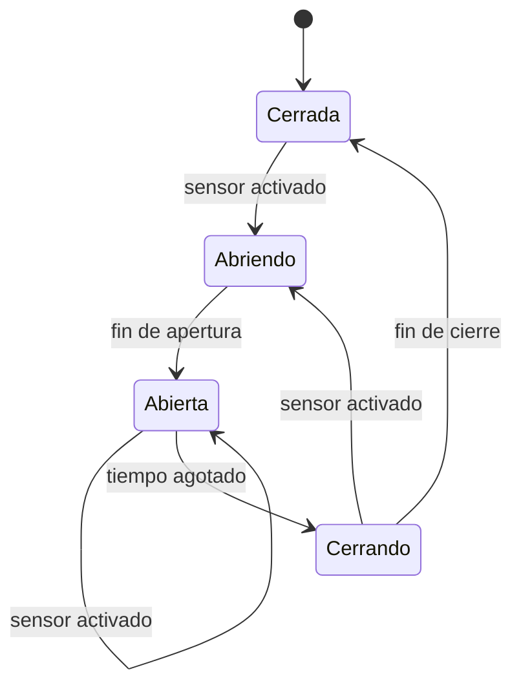
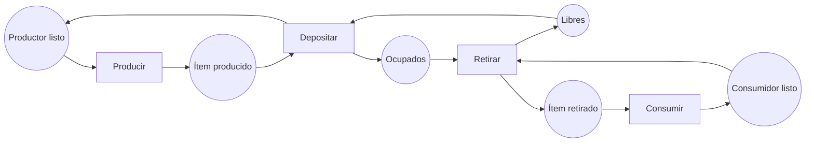

# Unidad 5 — Especificación del Software (Resuelto)

**Materia:** Ingeniería de Software 1 · **Preguntas:** 18 + 2 cuadros

---

## Tema 1 — Utilidad y cualidades de las especificaciones

### 1. La especificación como "contrato"

Como en un contrato, hay dos partes con obligaciones y derechos:

- **Quien usa el componente** debe cumplir la **precondición** (su obligación) y obtiene la garantía del resultado (su derecho).
- **Quien produce el componente** debe garantizar la **postcondición** (su obligación) siempre que se cumpla la precondición (su derecho).

Si la precondición no se cumple, el productor no garantiza nada.

**Ejemplo** (módulo `Inventario` de un sistema de ventas):

```
descontarStock(idProducto, cantidad)
  Pre:  el producto existe ∧ cantidad > 0 ∧ stock(idProducto) ≥ cantidad
  Post: stock'(idProducto) = stock(idProducto) − cantidad
```

### 2. Usos de una especificación en el ciclo de vida

1. **Comunicación:** lenguaje común entre cliente, analistas y desarrolladores.
2. **Guía de diseño e implementación:** dice *qué* debe hacer cada componente, sin imponer *cómo*.
3. **Base de verificación y pruebas:** de pre/postcondiciones se derivan casos de prueba y se comprueba la corrección.
4. **Mantenimiento y documentación:** permite entender el sistema y evaluar el impacto de un cambio.
5. **Referencia contractual:** define qué se debe entregar y qué se considera defecto.

### 3. Ambigüedad del requisito (aplicación)

Sean:

- **A** = "el pedido supera 5.000.000 Gs."
- **B** = "el pedido tiene más de 10 ítems"
- **C** = "el cliente es mayorista"

La ambigüedad está en el alcance de "y el cliente no sea mayorista": ¿afecta solo a B o a (A ∨ B)?

| Lectura | Fórmula | Pedido de 8.000.000 Gs. de un mayorista |
| --- | --- | --- |
| 1 | (A ∨ B) ∧ ¬C | **No** notifica |
| 2 | A ∨ (B ∧ ¬C) | **Sí** notifica |

**Redacción sin ambigüedad (lectura 1):**

> "El sistema notificará al cliente y al vendedor cuando se cumplan **ambas** condiciones: (1) el cliente no es mayorista, y (2) el pedido supera 5.000.000 Gs. **o** tiene más de 10 ítems."

### 4. Verdadero o Falso

**Falso.** Que defina todos los términos que usa es *completitud interna*. No implica *completitud externa*: puede definir todo lo que menciona y aun así omitir requisitos o situaciones (por ejemplo, qué ocurre ante un error). Tampoco garantiza consistencia ni corrección.

---

## Tema 2 — Estilos de especificación y su verificación

### 5. Operacional vs. descriptiva

- **Operacional:** describe *cómo* se obtiene el resultado, mediante un modelo ejecutable o un procedimiento.
- **Descriptiva:** describe *qué* propiedades debe cumplir el resultado, sin decir cómo se calcula.

**Máximo de un arreglo, operacional:**

```
m := a[0]
para i desde 1 hasta n−1:
    si a[i] > m entonces m := a[i]
devolver m
```

**Máximo de un arreglo, descriptiva:**

```
Pre:  n ≥ 1
Post: (∃k: 0 ≤ k < n: a[k] = m) ∧ (∀k: 0 ≤ k < n: a[k] ≤ m)
```

### 6. Grado de formalidad

Es el rigor con que están definidas la **sintaxis y la semántica** de la notación.

| Grado | Ejemplo | Justificación |
| --- | --- | --- |
| Informal | Requisitos en lenguaje natural | Sin sintaxis ni semántica definidas; admite ambigüedad. |
| Semiformal | DFD, diagrama ER, UML | Sintaxis definida, pero semántica no completamente matemática. |
| Formal | Notación Z, especificación algebraica | Sintaxis y semántica matemáticas; permite razonar y demostrar. |

### 7. Validación vs. verificación

- **Validación:** ¿la especificación describe lo que el cliente realmente necesita? ("¿Estamos especificando el sistema correcto?")
- **Verificación:** ¿la especificación es consistente, completa y sin ambigüedades, y el producto la cumple? ("¿Lo estamos haciendo correctamente?")

**Sin el cliente se puede hacer la verificación**, porque se apoya en criterios técnicos (revisiones, chequeo de consistencia, análisis de propiedades). La validación necesita al cliente, pues solo él sabe qué necesita.

---

## Tema 3 — Especificaciones operacionales

### 8. DFD nivel 1: préstamo de libros (aplicación)



### 9. Lo que el DFD no permite responder

1. **¿En qué orden y bajo qué condiciones se ejecutan los procesos?** (por ejemplo, ¿qué pasa si el libro no está disponible?). *Limitación:* el DFD no representa control ni secuencia temporal, solo el flujo de datos.
2. **¿Cuántos libros puede llevar un socio a la vez y por cuántos días?** *Limitación:* el DFD no expresa la lógica interna de los procesos ni reglas sobre los datos; hace falta una especificación complementaria (mini-especificación, pre/postcondiciones).

### 10. MEF: puerta automática (aplicación)



**Tabla de transición** (estado inicial: *Cerrada*; "—" = sin cambio):

| Estado \\ Entrada | sensor activado | fin de apertura | fin de cierre | tiempo agotado |
| --- | --- | --- | --- | --- |
| **Cerrada** | Abriendo | — | — | — |
| **Abriendo** | — | Abierta | — | — |
| **Abierta** | Abierta (reinicia temporizador) | — | — | Cerrando |
| **Cerrando** | Abriendo | — | Cerrada | — |

### 11. Red de Petri: productor–consumidor con buffer de capacidad 2 (aplicación)



**Marcado inicial** M₀: Productor listo = 1, Ítem producido = 0, **Libres = 2**, **Ocupados = 0**, Consumidor listo = 1, Ítem retirado = 0.

**Buffer lleno:** cuando **Libres = 0** y **Ocupados = 2**. En ese marcado *Depositar* queda deshabilitada (le falta un token en *Libres*), así que el productor se bloquea hasta que *Retirar* libere un lugar. La red cumple siempre Libres + Ocupados = 2.

---

## Tema 4 — Especificaciones descriptivas

### 12. `insertarOrdenado(a, n, x)`

```
Pre:  n ≥ 0
      ∧ a tiene capacidad para al menos n+1 elementos
      ∧ (∀i: 0 ≤ i < n−1: a[i] ≤ a[i+1])          -- a[0..n−1] ordenado

Post: n' = n + 1
      ∧ (∀i: 0 ≤ i < n: a'[i] ≤ a'[i+1])           -- a'[0..n] ordenado
      ∧ elementos(a'[0..n]) = elementos(a[0..n−1]) ∪ {x}   -- multiconjunto: se conserva todo y se agrega x
```

### 13. Raíz cuadrada entera

**Valor que cumple la postcondición sin ser el esperado:** `r = 0`. Como `0 · 0 = 0 ≤ x` para todo `x ≥ 0`, cumple siempre (para `x = 9` el esperado es 3, pero 0 o 2 también la cumplen). La especificación es **demasiado débil**: falta exigir que `r` sea el mayor entero posible.

**Corrección:**

```
{ x ≥ 0 }  r := raiz(x)  { r ≥ 0 ∧ r · r ≤ x < (r + 1) · (r + 1) }
```

### 14. TAD `Cola` (especificación algebraica)

**Signatura:**

```
TAD Cola[Elem]
  nueva      :                → Cola
  encolar    : Cola × Elem    → Cola
  desencolar : Cola           → Cola      (parcial: requiere ¬esVacía)
  frente     : Cola           → Elem      (parcial: requiere ¬esVacía)
  esVacía    : Cola           → Bool
```

**Axiomas** (c : Cola, e, f : Elem):

| # | Axioma |
| --- | --- |
| A1 | `esVacía(nueva) = verdadero` |
| A2 | `esVacía(encolar(c, e)) = falso` |
| A3 | `frente(encolar(c, e)) = si esVacía(c) entonces e sino frente(c)` |
| A4 | `desencolar(encolar(c, e)) = si esVacía(c) entonces nueva sino encolar(desencolar(c), e)` |

`frente(nueva)` y `desencolar(nueva)` quedan sin definir (error).

**Reescritura de** `frente(desencolar(encolar(encolar(nueva, 4), 9)))`:

1. `desencolar(encolar(encolar(nueva,4), 9))` = `si esVacía(encolar(nueva,4)) entonces nueva sino encolar(desencolar(encolar(nueva,4)), 9)` *(A4)*
2. `esVacía(encolar(nueva,4)) = falso` *(A2)*, entonces = `encolar(desencolar(encolar(nueva,4)), 9)`
3. `desencolar(encolar(nueva,4))` = `si esVacía(nueva) entonces nueva sino …` *(A4)*; como `esVacía(nueva) = verdadero` *(A1)*, = `nueva`
4. Queda `frente(encolar(nueva, 9))` = `si esVacía(nueva) entonces 9 sino …` *(A3)* = **9** *(A1)*

**Resultado: `9`**

---

## Tema 5 — Construcción y uso en la práctica

### 15. Notaciones para el sistema de turnos médicos

| Aspecto | Notación elegida | Justificación |
| --- | --- | --- |
| (a) Datos de pacientes, médicos y turnos | **Diagrama Entidad-Relación** (o esquemas Z si se necesitan invariantes formales) | Muestra entidades, atributos y relaciones (un médico tiene muchos turnos, un paciente reserva turnos) de forma clara y legible por el cliente. |
| (b) Estados de un turno | **Máquina de estados finitos** (Reservado → Confirmado → Atendido / Cancelado / Ausente) | El comportamiento depende del estado y de eventos que producen transiciones. |
| (c) Efecto de "cancelar turno" | **Pre y postcondiciones** | Describe *qué* debe cumplirse antes y después, sin fijar el procedimiento. |

### 16. Historia de usuario: cancelar turno

> **Como** paciente, **quiero** cancelar mi turno, **para** liberar el horario y no ocupar un lugar que no voy a usar.

**Escenario 1: cancelación válida**

- **Dado** que tengo un turno *Reservado* que comienza dentro de más de 24 horas → **precondición**
- **Cuando** cancelo el turno → *operación invocada*
- **Entonces** el turno queda *Cancelado* y el horario vuelve a estar disponible → **postcondición**

**Escenario 2: cancelación fuera de plazo**

- **Dado** que mi turno comienza en menos de 24 horas → **precondición no cumplida**
- **Cuando** intento cancelarlo → *operación invocada*
- **Entonces** el sistema rechaza la cancelación y el turno sigue *Reservado* → **postcondición** (comportamiento ante la violación de la precondición)

---

## Tema 6 — Especificación basada en modelos y otros modelos

### 17. Algebraica vs. basada en modelos

|  | Algebraica | Basada en modelos |
| --- | --- | --- |
| **Estado** | **Implícito:** no se describe; solo se conoce por el comportamiento observable de las operaciones, definido con axiomas. | **Explícito:** se modela con estructuras matemáticas (conjuntos, secuencias, relaciones) y las operaciones lo transforman con pre/postcondiciones. |
| **Lenguaje representativo** | OBJ, CASL, Larch | Z, VDM, B (también OCL) |

### 18. `CuentaBancaria` (Z y OCL)

**OCL:**

```ocl
context CuentaBancaria
inv: self.saldo >= 0

context CuentaBancaria::extraer(monto : Integer)
pre:  monto > 0 and monto <= self.saldo
post: self.saldo = self.saldo@pre - monto
```

**Z:**

```
┌─ CuentaBancaria ──────────
│ saldo : ℤ
├───────────────────────────
│ saldo ≥ 0                    -- invariante
└───────────────────────────

┌─ Extraer ─────────────────
│ ΔCuentaBancaria
│ monto? : ℤ
├───────────────────────────
│ monto? > 0                   -- precondición
│ monto? ≤ saldo               -- precondición
│ saldo' = saldo − monto?      -- postcondición
└───────────────────────────
```

---

## Cuadro de clasificación

| Notación | Operacional | Descriptiva | Semiformal | Formal |
| --- | --- | --- | --- | --- |
| Diagrama de flujo de datos (DFD) | X |  | X |  |
| Máquina de estados finitos | X |  |  | X |
| Red de Petri | X |  |  | X |
| Diagrama Entidad-Relación |  | X | X |  |
| Pre y postcondiciones en lógica de primer orden |  | X |  | X |
| Especificación algebraica |  | X |  | X |
| Esquemas en notación Z |  | X |  | X |
| Escenarios Dado / Cuando / Entonces |  | X | X |  |

## Cuadro de relación

| Columna A | Columna B | Respuesta |
| --- | --- | --- |
| 1. Completitud interna | c. Todo término usado en la especificación está definido en ella | **c** |
| 2. Explosión de estados | e. Crecimiento multiplicativo del número de estados al componer máquinas | **e** |
| 3. Token | a. Marca que indica que una condición se cumple en un lugar de una red de Petri | **a** |
| 4. Axioma | b. Ecuación que relaciona las operaciones de un tipo abstracto de datos | **b** |
| 5. Invariante | d. Condición que debe cumplirse siempre, antes y después de cada operación | **d** |
| 6. Precondición | f. Lo que debe ser verdadero antes de invocar una operación para que esta garantice su resultado | **f** |