# DevStudy — Entrega 2: Análisis

**Materia:** Ingeniería de Software · **Profesor:** Ing. Fernando Jose Lesme **Integrantes:** Luis Saucedo · Federico Arrua · Elias Salinas · Lucas Perez

> Este documento define **qué debe hacer DevStudy**, desde la perspectiva del negocio y del usuario, y sirve de base para el diseño técnico de la Entrega 3.

---

## 1. Distribución de responsabilidades

| Tópico | Responsable | Estado |
| --- | --- | --- |
| 2. Requisitos funcionales | **Lucas Perez** | Completo |
| 3. Requisitos no funcionales | Luis Saucedo | Pendiente |
| 4. Modelo de casos de uso | **Lucas Perez** | Completo |
| 5. Modelo de dominio | Federico Arrua | Pendiente |
| 6. Diagramas de comportamiento | Federico Arrua | Pendiente |
| 7. Prototipo de interfaz (mockups) | Elias Salinas | Pendiente |
| 8. Reglas del negocio | Luis Saucedo | Pendiente |
| 9. Matriz de trazabilidad | Elias Salinas | Pendiente |

### Convenciones comunes (para que todos usemos los mismos códigos)

- **Actores:** Estudiante, Docente, Administrador (según el glosario de la Entrega 1).
- **Identificadores:** `RF-xx` requisitos funcionales · `RNF-xx` no funcionales · `CU-xx` casos de uso · `RN-xx` reglas del negocio.
- **Prioridad:** **Alta** = imprescindible para la V1.0 · **Media** = importante · **Baja** = deseable.

---

## 2. Requisitos funcionales *(Lucas Perez)*

| ID | Requisito: el sistema deberá... | Prioridad | Criterio de verificación |
| --- | --- | --- | --- |
| RF-01 | Permitir el registro de usuarios con nombre, correo y contraseña. | Alta | Con datos válidos y correo no usado se crea una cuenta con rol Estudiante; un correo repetido es rechazado. |
| RF-02 | Permitir iniciar y cerrar sesión, y restablecer la contraseña por correo. | Alta | Credenciales correctas dan acceso al panel del rol; incorrectas, no; tras cerrar sesión no se accede a páginas protegidas. |
| RF-03 | Permitir al Administrador crear, editar y desactivar usuarios y asignarles rol. | Alta | Un usuario desactivado no puede iniciar sesión; el rol asignado determina las opciones visibles. |
| RF-04 | Permitir al Administrador crear, editar y archivar materias. | Alta | La materia creada aparece en el catálogo; una archivada deja de ofrecerse para inscripción. |
| RF-05 | Permitir al Administrador asignar docentes a una materia. | Alta | Solo los docentes asignados ven las opciones de publicación de esa materia. |
| RF-06 | Permitir al Estudiante inscribirse en materias activas. | Alta | Tras inscribirse accede al contenido de la materia; no puede inscribirse dos veces en la misma. |
| RF-07 | Permitir al Docente publicar material (título, descripción, tema, archivo o enlace). | Alta | El material publicado es visible para los inscriptos de esa materia. |
| RF-08 | Permitir al Docente editar o eliminar el material que publicó. | Media | Los cambios se reflejan de inmediato; la eliminación pide confirmación. |
| RF-09 | Permitir consultar y descargar el material organizado por materia y tema. | Alta | Solo usuarios inscriptos (o docentes de la materia) acceden al material. |
| RF-10 | Permitir buscar y filtrar material por materia, tema, tipo y palabra clave. | Media | Los resultados contienen solo material que cumple todos los filtros aplicados. |
| RF-11 | Permitir al Docente publicar ejercicios de programación (título, enunciado, tema, dificultad, fecha límite). | Alta | El ejercicio aparece a los inscriptos con su fecha límite. |
| RF-12 | Permitir al Estudiante entregar su resolución de un ejercicio (archivo o código). | Alta | La entrega queda registrada con fecha y hora y visible para el docente. |
| RF-13 | Permitir al Docente calificar una entrega y dejar retroalimentación. | Alta | El estudiante ve la calificación y los comentarios de su entrega. |
| RF-14 | Permitir al Estudiante marcar un material como completado. | Media | El material queda marcado y se refleja en el progreso de la materia. |
| RF-15 | Mostrar al Estudiante un panel de progreso por materia (avance, pendientes, calificaciones). | Alta | El panel coincide con los materiales completados y las entregas realizadas. |
| RF-16 | Mostrar al Docente el avance de sus estudiantes y las entregas pendientes de revisión. | Media | La lista de pendientes incluye todas las entregas sin evaluar de sus materias. |
| RF-17 | Permitir crear consultas en el foro de una materia (con tema asociado y fragmento de código). | Alta | La consulta aparece en el foro de esa materia. |
| RF-18 | Permitir a Estudiantes y Docentes responder consultas. | Alta | La respuesta se muestra bajo la consulta con autor y fecha. |
| RF-19 | Permitir marcar una respuesta como solución y cerrar la consulta (autor o Docente). | Baja | La consulta cerrada muestra la solución destacada y no admite nuevas respuestas. |
| RF-20 | Permitir al Docente y al Administrador ocultar o eliminar contenido inapropiado del foro. | Media | El contenido ocultado deja de mostrarse a los demás usuarios. |
| RF-21 | Enviar notificaciones internas (material nuevo, ejercicio nuevo, respuesta, evaluación). | Baja | El usuario ve la notificación al ingresar y puede marcarla como leída. |

**Fuera del alcance de la V1.0** *(propuesta, a validar con el grupo)*: chat en tiempo real, ejecución y corrección automática de código, autoevaluaciones con corrección automática, aplicación móvil nativa e integración con el sistema académico de la universidad.

---

## 3. Requisitos no funcionales *(Luis Saucedo)*

**Pendiente.** Cubrir: rendimiento, seguridad, usabilidad, disponibilidad, escalabilidad y portabilidad, con valores medibles. Referencias de la Entrega 1: interfaz responsiva y de carga rápida, stack React + Node.js/Express + PostgreSQL.

---

## 4. Modelo de casos de uso *(Lucas Perez)*

### 4.1 Diagrama de casos de uso

**Nota:** todos los casos de uso, excepto CU-01 y CU-02, tienen como precondición una sesión iniciada con el rol indicado.

### 4.2 Resumen de casos de uso

| ID | Caso de uso | Actor(es) | RF cubiertos |
| --- | --- | --- | --- |
| CU-01 | Registrarse | Estudiante | RF-01 |
| CU-02 | Iniciar sesión | Todos | RF-02 |
| CU-03 | Gestionar usuarios y roles | Administrador | RF-03 |
| CU-04 | Gestionar materias y docentes | Administrador | RF-04, RF-05 |
| CU-05 | Inscribirse en una materia | Estudiante | RF-06 |
| CU-06 | Publicar material | Docente | RF-07, RF-08 |
| CU-07 | Consultar y descargar material | Estudiante, Docente | RF-09 |
| CU-08 | Buscar y filtrar material | Estudiante, Docente | RF-10 |
| CU-09 | Marcar material como completado | Estudiante | RF-14 |
| CU-10 | Publicar ejercicio | Docente | RF-11 |
| CU-11 | Entregar ejercicio | Estudiante | RF-12 |
| CU-12 | Evaluar entrega | Docente | RF-13 |
| CU-13 | Consultar progreso | Estudiante | RF-15 |
| CU-14 | Seguimiento del curso | Docente | RF-16 |
| CU-15 | Publicar consulta en el foro | Estudiante | RF-17 |
| CU-16 | Responder consulta | Estudiante, Docente | RF-18, RF-19 |
| CU-17 | Moderar foro | Docente, Administrador | RF-20 |
| CU-18 | Ver notificaciones | Estudiante, Docente | RF-21 |

### 4.3 Especificación detallada de los casos de uso principales

#### CU-02 — Iniciar sesión

- **Actores:** Estudiante, Docente, Administrador · **RF:** RF-02
- **Precondiciones:** el usuario tiene una cuenta activa.
- **Flujo principal:**
  1. El usuario abre la pantalla de inicio de sesión.
  2. Ingresa su correo y contraseña.
  3. El sistema valida las credenciales.
  4. El sistema inicia la sesión y muestra el panel correspondiente a su rol.
- **Flujos alternativos:**
  - *3a. Credenciales incorrectas:* el sistema muestra un mensaje genérico y vuelve al paso 2.
  - *3b. Cuenta desactivada:* el sistema informa que debe contactar al administrador.
  - *2a. Olvidó su contraseña:* solicita el restablecimiento; el sistema envía un enlace al correo registrado.
  - *4a. Cerrar sesión:* el usuario elige "Cerrar sesión" y el sistema invalida la sesión.
- **Postcondiciones:** hay una sesión activa asociada al rol del usuario (o la sesión fue cerrada).

#### CU-05 — Inscribirse en una materia

- **Actor:** Estudiante · **RF:** RF-06
- **Precondiciones:** sesión iniciada como Estudiante; existen materias activas.
- **Flujo principal:**
  1. El estudiante abre el catálogo de materias.
  2. El sistema lista las materias activas en las que aún no está inscripto.
  3. El estudiante elige una materia y selecciona "Inscribirme".
  4. El sistema registra la inscripción.
  5. El sistema confirma y la materia aparece en "Mis materias".
- **Flujos alternativos:**
  - *4a. La materia fue archivada mientras tanto:* el sistema informa el error y actualiza el catálogo.
  - *2a. No hay materias disponibles:* el sistema muestra un mensaje informativo.
- **Postcondiciones:** inscripción activa; el estudiante accede al material, ejercicios y foro de la materia, con progreso inicial en 0 %.

#### CU-06 — Publicar material

- **Actor:** Docente · **RF:** RF-07, RF-08
- **Precondiciones:** sesión iniciada como Docente asignado a la materia.
- **Flujo principal:**
  1. El docente entra a su materia y elige "Nuevo material".
  2. El sistema muestra el formulario (título, descripción, tema, archivo o enlace).
  3. El docente completa los datos y adjunta el archivo o enlace.
  4. El sistema valida los datos.
  5. El sistema publica el material, visible para los inscriptos.
  6. El sistema genera notificaciones (CU-18).
- **Flujos alternativos:**
  - *4a. Datos obligatorios faltantes o archivo con formato o tamaño no permitido:* el sistema indica el error y vuelve al paso 3.
  - *4b. Enlace con formato inválido:* el sistema lo rechaza y vuelve al paso 3.
  - *1a. Editar o eliminar material propio:* el docente selecciona un material suyo y lo modifica o lo elimina (con confirmación); el cambio se refleja de inmediato.
- **Postcondiciones:** el material queda disponible en la materia y tema; los inscriptos fueron notificados.

#### CU-07 — Consultar y descargar material

- **Actores:** Estudiante, Docente · **RF:** RF-09
- **Precondiciones:** sesión iniciada; el estudiante está inscripto en la materia (o el docente está asignado a ella).
- **Flujo principal:**
  1. El usuario abre "Mis materias" y elige una.
  2. El sistema muestra el material organizado por tema.
  3. El usuario selecciona un material.
  4. El sistema muestra su detalle y ofrece verlo o descargarlo.
  5. El usuario lo visualiza o lo descarga.
- **Flujos alternativos:**
  - *2a. La materia no tiene material:* el sistema informa que aún no hay contenido.
  - *3a. Buscar y filtrar:* se ejecuta CU-08 (extend).
  - *4a. Marcar como completado:* se ejecuta CU-09 (extend).
  - *5a. Archivo no disponible:* el sistema muestra un mensaje de error.
- **Postcondiciones:** el usuario accedió al material; no se modifican los datos del material.

#### CU-10 — Publicar ejercicio de programación

- **Actor:** Docente · **RF:** RF-11
- **Precondiciones:** sesión iniciada como Docente asignado a la materia.
- **Flujo principal:**
  1. El docente elige "Nuevo ejercicio" dentro de su materia.
  2. El sistema muestra el formulario (título, enunciado, tema, dificultad, fecha límite, archivos de apoyo opcionales).
  3. El docente completa y confirma.
  4. El sistema valida los datos.
  5. El sistema publica el ejercicio y notifica a los inscriptos.
- **Flujos alternativos:**
  - *4a. Datos faltantes o fecha límite anterior a la fecha actual:* el sistema indica el error y vuelve al paso 3.
- **Postcondiciones:** el ejercicio es visible y habilitado para recibir entregas hasta su fecha límite.

#### CU-11 — Entregar ejercicio

- **Actor:** Estudiante · **RF:** RF-12
- **Precondiciones:** sesión iniciada; inscripto en la materia; ejercicio publicado y dentro del plazo.
- **Flujo principal:**
  1. El estudiante abre el ejercicio desde su materia.
  2. El sistema muestra el enunciado, el estado de la entrega y la fecha límite.
  3. El estudiante elige "Entregar solución".
  4. Adjunta un archivo o pega su código y, opcionalmente, un comentario.
  5. El sistema valida y registra la entrega con fecha y hora.
  6. El sistema confirma y marca el estado como "Entregado".
- **Flujos alternativos:**
  - *5a. Fuera de plazo:* el sistema aplica la política de entregas tardías de la materia (a definir en las reglas del negocio).
  - *5b. Archivo con formato o tamaño no permitido:* el sistema indica el error y vuelve al paso 4.
  - *3a. Ya existe una entrega:* el sistema permite reemplazarla solo si aún no fue evaluada (a confirmar en las reglas del negocio).
- **Postcondiciones:** la entrega queda registrada y aparece en las pendientes de revisión del docente; el progreso del estudiante se actualiza.

#### CU-12 — Evaluar entrega y dar retroalimentación

- **Actor:** Docente · **RF:** RF-13
- **Precondiciones:** sesión iniciada como Docente de la materia; existe al menos una entrega sin evaluar.
- **Flujo principal:**
  1. El docente abre "Entregas pendientes".
  2. El sistema lista las entregas sin evaluar de sus materias.
  3. El docente selecciona una entrega y revisa la solución.
  4. Ingresa la calificación y sus comentarios.
  5. Confirma la evaluación.
  6. El sistema guarda el resultado, cambia el estado a "Evaluado" y notifica al estudiante.
- **Flujos alternativos:**
  - *4a. Calificación fuera del rango permitido:* el sistema la rechaza y vuelve al paso 4.
  - *4b. Solicitar corrección:* el docente devuelve la entrega con observaciones, sin calificar; queda como "Con observaciones" y el estudiante puede reenviarla.
- **Postcondiciones:** la evaluación es visible para el estudiante y se refleja en su progreso.

#### CU-13 — Consultar progreso académico

- **Actor:** Estudiante · **RF:** RF-15
- **Precondiciones:** sesión iniciada; inscripto en al menos una materia.
- **Flujo principal:**
  1. El estudiante abre "Mi progreso".
  2. El sistema muestra, por materia, el porcentaje de avance, los materiales completados, los ejercicios entregados y evaluados, y las calificaciones.
  3. El estudiante selecciona una materia.
  4. El sistema muestra los temas pendientes y las entregas próximas a vencer.
- **Flujos alternativos:**
  - *2a. Sin inscripciones:* el sistema invita a inscribirse en una materia (CU-05).
  - *4a. Materia sin contenido publicado:* el sistema muestra "Sin contenido" en lugar de un porcentaje.
- **Postcondiciones:** no se modifican datos.

#### CU-15 — Publicar consulta en el foro

- **Actor:** Estudiante · **RF:** RF-17
- **Precondiciones:** sesión iniciada; inscripto en la materia.
- **Flujo principal:**
  1. El estudiante abre el foro de la materia y elige "Nueva consulta".
  2. Completa título, descripción, tema asociado y, opcionalmente, un fragmento de código.
  3. El sistema valida los datos.
  4. El sistema publica la consulta y notifica a los docentes de la materia.
- **Flujos alternativos:**
  - *3a. Campos obligatorios vacíos:* el sistema indica los faltantes y vuelve al paso 2.
  - *2a. Hay consultas similares:* el sistema sugiere hilos existentes antes de publicar; el estudiante puede continuar igualmente.
- **Postcondiciones:** la consulta queda abierta y visible en el foro de la materia.

---

## 5. Modelo de dominio *(Federico Arrua)*

**Pendiente.** Diagrama de clases conceptual con entidades, atributos principales y relaciones, sin detalles de implementación.

---

## 6. Diagramas de comportamiento *(Federico Arrua)*

**Pendiente.** Diagramas de secuencia o de actividad de los flujos principales de la sección 4.3. Sugeridos: CU-06, CU-11, CU-12 y CU-15/CU-16.

---

## 7. Prototipo de interfaz (mockups) *(Elias Salinas)*

**Pendiente.** Wireframes de baja fidelidad de las pantallas principales. Sugeridas a partir de los casos de uso: inicio de sesión, panel del estudiante (mis materias y progreso), vista de materia, detalle de ejercicio y entrega, panel docente (entregas pendientes), foro y administración.

---

## 8. Reglas del negocio *(Luis Saucedo)*

**Pendiente.** Varios puntos de la sección 4.3 quedaron marcados "a definir en las reglas del negocio": política de entregas tardías y de reenvío, rango de calificación, formatos y tamaño máximo de archivos, y forma de calcular el porcentaje de avance.

---

## 9. Matriz de trazabilidad *(Elias Salinas)*

**Pendiente.** Relación RF-01…RF-21 con CU-01…CU-18. La columna "RF cubiertos" de la tabla 4.2 sirve como punto de partida.